# Fleetwake

**A real-time control room for vehicle fleets.** Every truck, shuttle and delivery van streams its position, speed, fuel and engine temperature once a second. Fleetwake checks and stores every reading, raises incidents the moment something goes wrong (or is about to), lets a dispatcher instruct the driver in one click, and keeps every connected screen up to date in well under half a second.

Built with **MongoDB · Express · React · Node.js · Socket.IO** for the MERNIFY hackathon, *High-Throughput Streams & Telemetry* track.

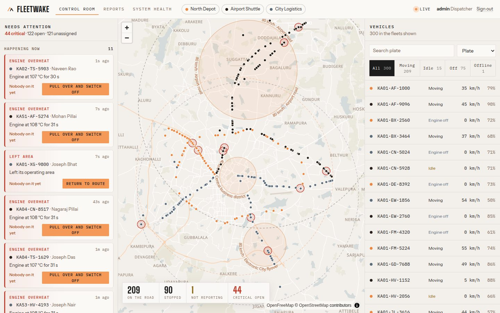

| | |
| --- | --- |
| **Scale tested** | 2,000 vehicles at 1 reading/s, 50 dashboards connected |
| **Vehicle to screen** | 238 ms median, 359 ms p95 |
| **Readings lost or double-counted** | 0 (all 119,457 saved; 1,777 duplicate and late readings dropped as designed) |
| **Early warnings** | Overheats forecast a median 78 s before the fixed rule; coolant leaks and fuel theft that no fixed rule can see |
| **Tests** | 35 unit tests, a load test, and an ML evaluation against ground truth |

---

## Contents

1. [The problem](#the-problem)
2. [What Fleetwake does](#what-fleetwake-does)
3. [Screenshots](#screenshots)
4. [Architecture](#architecture)
5. [Tech stack](#tech-stack)
6. [Data generation and ingestion](#data-generation-and-ingestion)
7. [Real-time communication](#real-time-communication)
8. [History and live data without duplicates](#history-and-live-data-without-duplicates)
9. [Incidents and driver instructions](#incidents-and-driver-instructions)
10. [Early warnings (machine learning)](#early-warnings-machine-learning)
11. [Performance](#performance)
12. [Getting started](#getting-started)
13. [Testing](#testing)
14. [Deployment](#deployment)
15. [Demo walkthrough](#demo-walkthrough)
16. [Requirements checklist](#requirements-checklist)
17. [Project structure](#project-structure)
18. [Credits](#credits)

The full design document, with more diagrams, the data model and the API reference, is in **[docs/ARCHITECTURE.md](docs/ARCHITECTURE.md)**.

---

## The problem

Fleets produce a continuous, high-frequency stream of telemetry. A logistics operator needs to see every vehicle live, catch unsafe or failing vehicles while there is still time to act, and give each team only the fleet it is responsible for, without screens lagging, freezing or showing duplicated or out-of-order data.

Fleetwake is the control room for a Bengaluru logistics company with three fleets:

| Fleet | What it does | Vehicles |
| --- | --- | --- |
| North Depot | Heavy trucks hauling building materials out of the Peenya industrial area | Trucks, vans |
| Airport Shuttle | Buses and cabs carrying passengers and crew to Kempegowda Airport | Buses, SUVs, sedans |
| City Logistics | Last-mile parcel deliveries across the city | Vans, bikes, sedans |

Two roles use it:
- **Dispatchers** watch every fleet and work incidents as they happen.
- **Fleet managers** see only their own fleet.

The vehicles are simulated (the brief allows it), driving real Bengaluru roads.

## What Fleetwake does

**Live operations: the Control room**
- Live map of every vehicle, coloured by fleet, with speed zones, each fleet's operating area, and a ring on any vehicle with an active incident.
- A **Needs attention** queue: open incidents, most urgent first, each with its driver and a one-click suggested instruction.
- Open any vehicle to see its driver, its last 5, 15 or 60 minutes joined seamlessly to its live readings, its open incidents, and what its learned model considers normal.

**Incidents and driver instructions**
- Nine detectors feed one incident queue.
  - Six fixed rules: overspeed, harsh braking, engine overheat, long idle, left area, not reporting.
  - Three learned early warnings: overheat forecast, unusual engine temperature, unexplained fuel loss.
- Repeats merge into one incident and escalate; incidents know when their condition has stopped; quiet ones close themselves.
- Dispatchers take ownership, **send the driver an instruction** (it reaches the vehicle in about 0.35 s, and the driver's confirmation comes back), log calls, add notes, and resolve with an outcome. Resolving can also book driver coaching or a maintenance check.

**Reports**
- Incidents per 100 km, time to take ownership and to resolve, and how incidents were closed.
- **Drivers to follow up**, with *Book coaching* and *Book check* buttons, plus a follow-up list to tick off.
- A **heatmap** of where incidents happen, incidents over time, and the fleets compared.

**System health** (dispatchers)
- A plain status (*All systems normal / Degraded / Problem*) built from seven checks, each saying what to do when it fails.
- Throughput and delivery-time charts, rejected readings by reason, and every connected screen by fleet.

**Built for unreliable, high-volume input**
- Every reading carries a vehicle id, a sequence number and a timestamp, so duplicates and late arrivals are dropped and counted, never double-counted.
- Schema validation, per-IP and per-device rate limits, device keys, and backpressure (503 + `Retry-After`).
- JWT logins with fleet-scoped access, enforced on every API call and every Socket.IO room.

## Screenshots

| | |
| --- | --- |
| 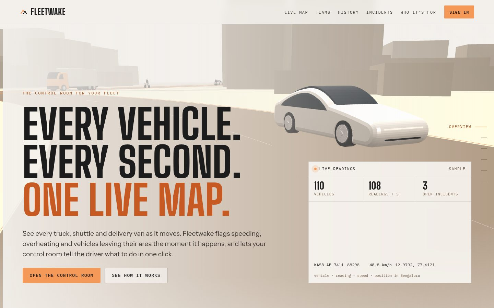 **Landing page** with a live Three.js city | 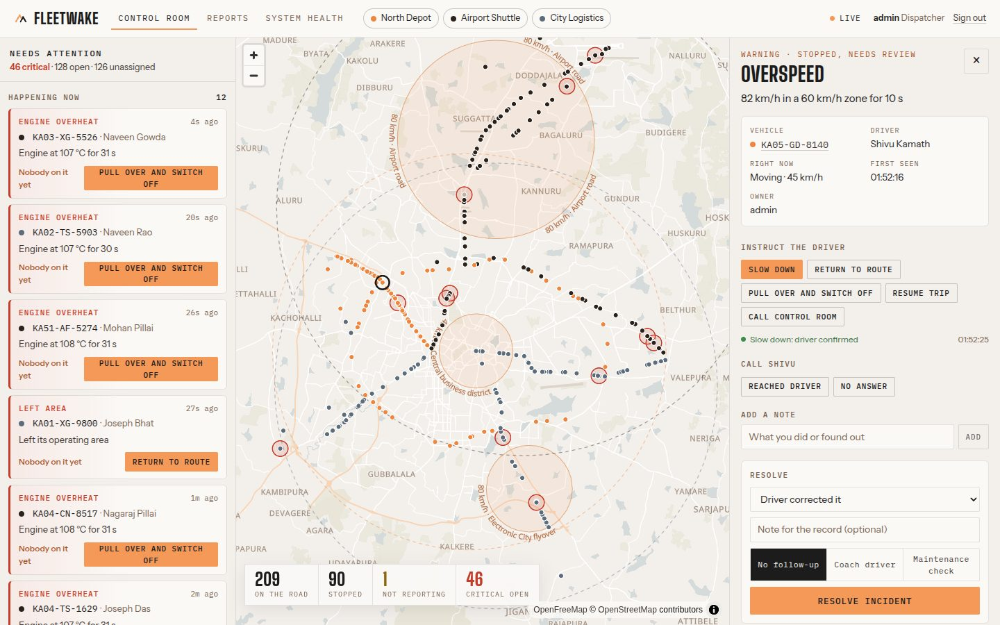 **Working an incident:** "Slow down" sent and confirmed by the driver |
| 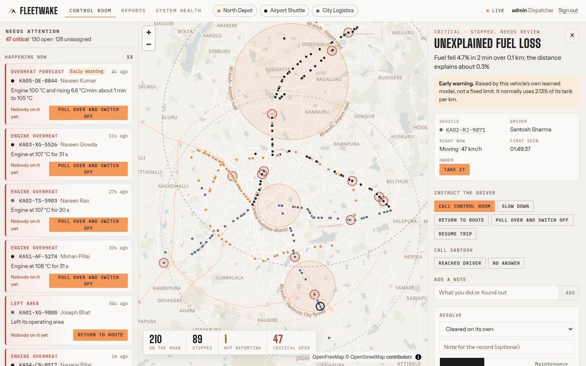 **Early warning** with the model's evidence | 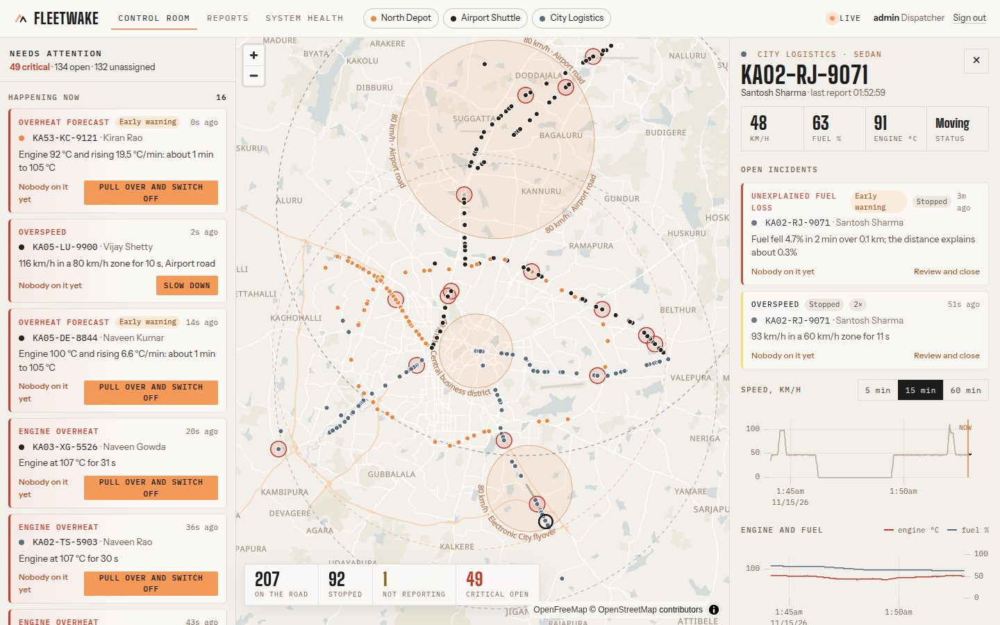 **Vehicle:** open incidents, last 15 minutes joined to live readings |
| 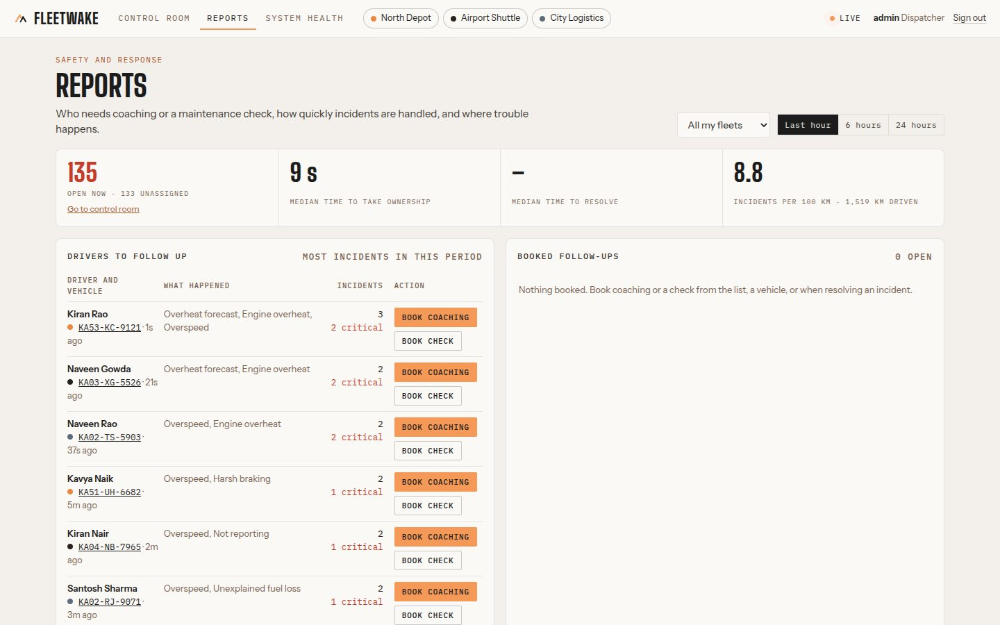 **Reports:** response times and drivers to follow up | 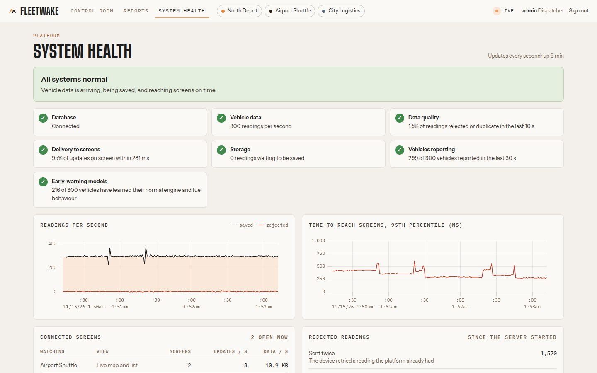 **System health:** checks, throughput, connected screens |
| 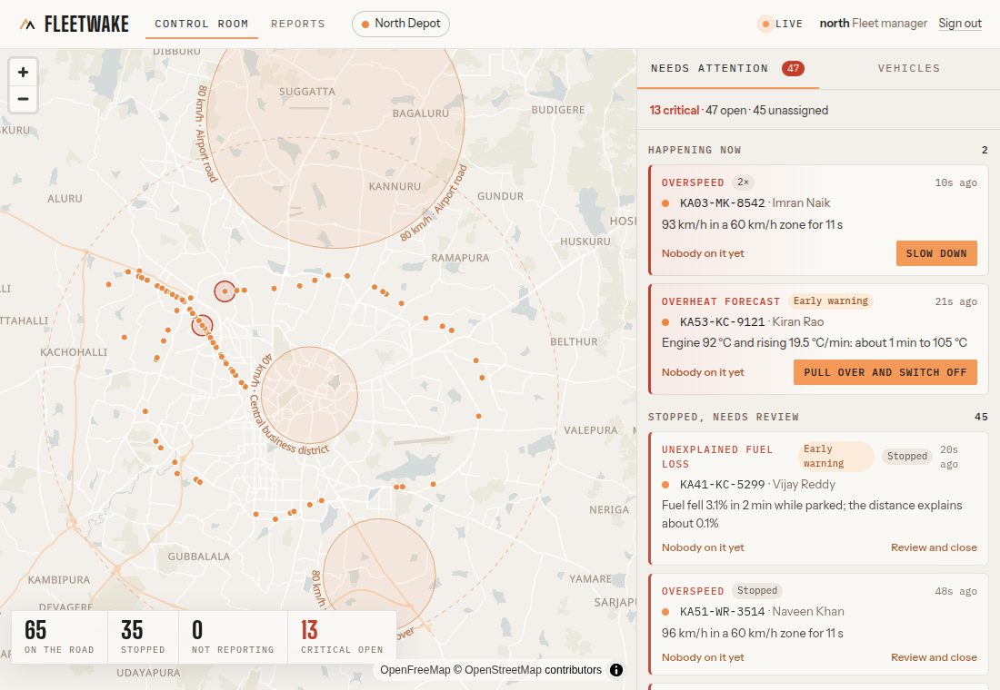 **Fleet manager** (`north`) sees only North Depot | 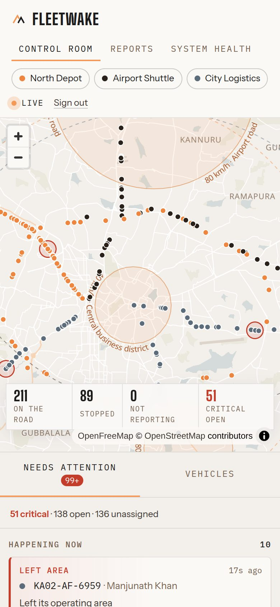 **Phone layout** |

## Architecture

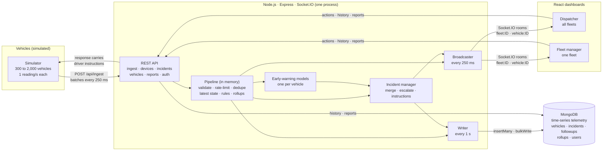

**How a reading flows**

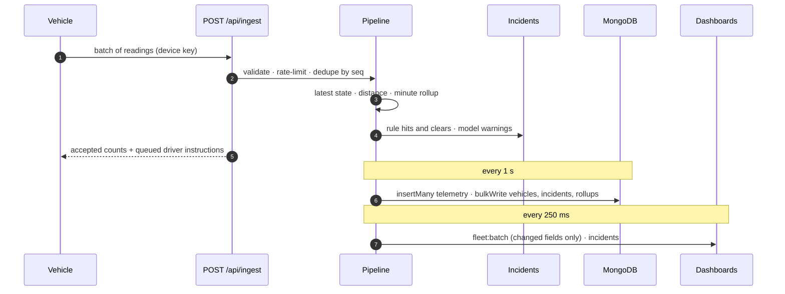

Everything that has to be fast happens in memory in one Node process: validation, dedupe, state, rules, models and incidents. The `Pipeline` class does no I/O itself, so it is unit-tested directly. Timers drain it to MongoDB every second and to the screens every 250 ms. More detail: [docs/ARCHITECTURE.md](docs/ARCHITECTURE.md).

## Tech stack

| Layer | Technology | Used for |
| --- | --- | --- |
| Database | **MongoDB** 7.0+ (tested on 8.0), Mongoose 9 | Time-series collection for raw telemetry (7-day TTL); vehicles, incidents, follow-ups, per-minute rollups, users |
| Server | **Node.js** 24, **Express** 5 | Device gateway, REST API, static hosting of the landing page and dashboard |
| Real-time | **Socket.IO** 4 | Rooms per fleet and per vehicle, 250 ms delta batches, incident updates, health metrics |
| Dashboard | **React** 19, React Router 7, Vite 8 | Control room, reports, system health |
| Maps and charts | MapLibre GL 6 (OpenFreeMap tiles), uPlot | Live map, incident heatmap, canvas charts |
| Validation and security | Zod 4, express-rate-limit, helmet, jsonwebtoken, bcryptjs | Schema checks, rate limits, headers, auth |
| Landing page | Three.js r128 | Scroll-driven 3D city |
| Machine learning | Plain JavaScript, no external service | Online per-vehicle models (weighted least squares, trend fitting) |

## Data generation and ingestion

**The simulator** (`simulator/index.js`) drives each vehicle along a real Bengaluru road: Outer Ring Road, Tumkur Road, Bellary Road, Hosur Road, Old Airport Road or Mysore Road (approximate traces in `shared/geo.js`).
- Speed follows a cruise target below the local limit.
- Engine temperature follows load with a realistic lag, and fuel drains with distance.
- Vehicles report at their own phase within each second, like unsynchronised devices.

It also injects what real fleets throw at a control room:

| Behaviour | Episodes |
| --- | --- |
| Driving | Speeding, hard stops, long idling, parking, leaving the operating area |
| Faults | A failing fan (overheat), a slow coolant leak, fuel siphoned while parked, losing signal in a dead zone |
| Network | 1% of readings sent twice, 0.5% delivered out of order, optional malformed readings (`--malformed`) |
| Drivers | Read dispatcher instructions after 3 to 9 s, confirm, and comply; about 1 in 12 never answers |

**A reading** identifies its source, its position in that source's stream, and when it was taken:

```json
{ "vehicleId": "KA01-AB-4471", "seq": 17945607879, "ts": 1794560807035, "type": "position",
  "lat": 12.97194, "lng": 77.59369, "speedKmh": 42.6, "fuelPct": 61, "engineC": 88, "heading": 74, "engineOn": true }
```

**Ingestion** (`POST /api/ingest`, batches of up to 1,000 readings):
1. **Gate.** Device API key, per-IP rate limit, 2 MB body limit. If the write buffer is full, the server answers **503 + `Retry-After`** and the vehicle keeps its data and retries.
2. **Validate.** A strict Zod schema rejects unknown fields and impossible values. Timestamps more than 60 s in the future or over 24 h old are rejected, and so are unregistered vehicles.
3. **Rate-limit each device** with a token bucket (5 readings/s, bursts of 20).
4. **Dedupe by `seq`.** Equal to the last accepted is a duplicate; lower is late. Both are dropped and counted.
5. **Process.** Update latest state and distance, run the rules and the vehicle's model, and add to the per-minute rollup.
6. **Store and broadcast.** Every second, one unordered `insertMany` into a **MongoDB time-series collection**, plus `bulkWrite`s for incidents and rollups. Every 250 ms, deltas go to the screens.

## Real-time communication

Dashboards connect with their JWT; the handshake is rejected without one.

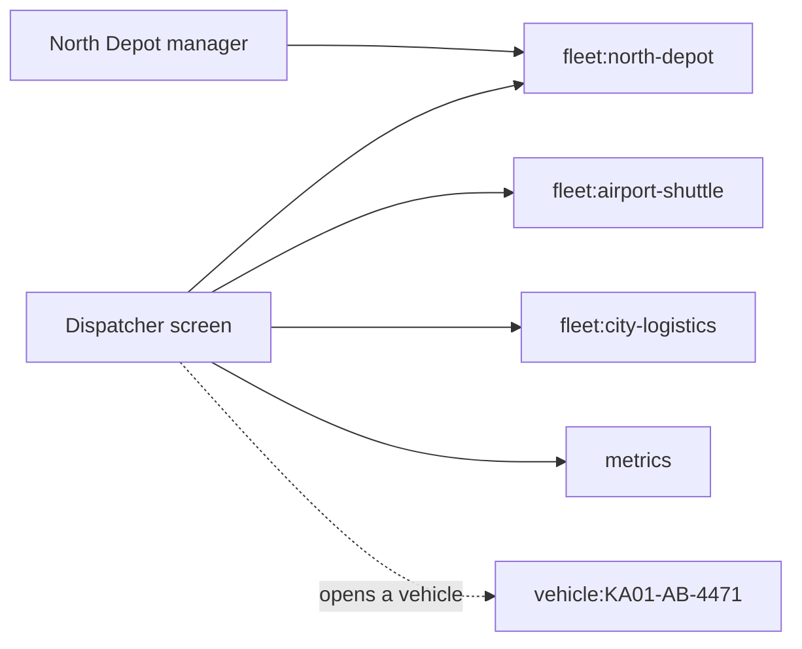

| Room | Joined by | Receives |
| --- | --- | --- |
| `fleet:<id>` | `subscribe { fleets }`, filtered to what the account may see; the reply carries a full snapshot | `fleet:batch` every 250 ms; `incidents` when one changes |
| `vehicle:<id>` | `watch` while a vehicle is open | `vehicle:events`, every raw reading of that vehicle |
| `metrics` | dispatchers only | health, throughput and connected screens, once a second |

**Selective, compact broadcasting** instead of re-sending application state:
- **Coalescing.** At most one entry per vehicle per 250 ms, however many readings arrived.
- **Field-level deltas.** Only the fields that moved, with short keys: `["KA01-AB-4471", 17945607880, 1794560808035, {"sp": 45}]`.
- **Per-vehicle streams** only for vehicles someone has open.
- **Slow clients** are taken out of their rooms and later given one fresh snapshot, never a growing queue.

**On the client**, socket messages update a plain store and React re-renders at most **4 times a second**. The vehicle list is windowed, the charts draw to canvas, and the map refreshes one data source per tick. A fleet manager's screen receives only its own fleet; System health lists every room and how many screens are in it.

## History and live data without duplicates

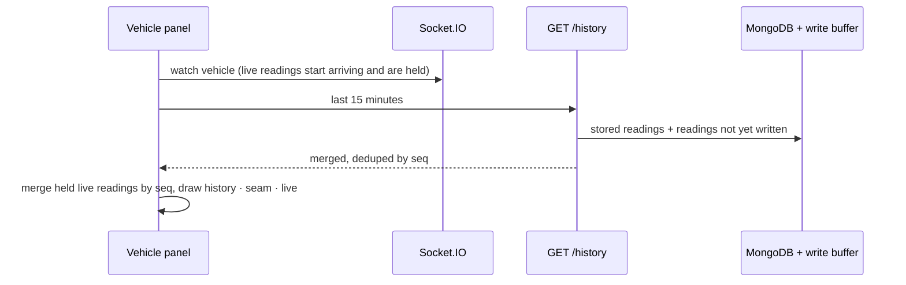

Joining the vehicle's room *before* loading history closes the gap on one side, because readings that arrive during the load are held. Including readings still in the server's write buffer closes the other side. Merging both by `seq` removes the overlap. The chart and map trail show where history ends and live data begins.

## Incidents and driver instructions

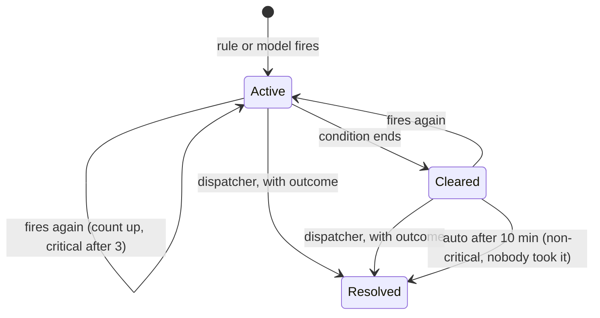

- **One incident per vehicle and problem**, so repeats don't flood the queue.
- **Driver instructions** (*Slow down*, *Return to route*, *Pull over and switch off*, *Resume trip*, *Call control room*) are queued, then delivered in the response to the vehicle's next upload. The driver confirms through `POST /api/devices/ack`.
  - Undelivered after 2 minutes: the instruction expires.
  - Delivered but unanswered after 60 s: the timeline says to call the driver.
- **Every step** (opened, repeated, escalated, instruction sent, delivered, confirmed, call, note, resolved) is in the incident's timeline with who did it.

## Early warnings (machine learning)

Fixed limits only fire once something is already wrong, and they can't tell a hot-running truck from a failing one. So each vehicle has its own small model on the server (`server/src/pipeline/ml.js`) that learns what is normal *for that vehicle*:

| Detector | What it learns | What it catches |
| --- | --- | --- |
| **Overheat forecast** | Engine temperature vs load (speed smoothed over the engine's ~50 s lag), then the trend of the heat load doesn't explain | An engine heading for 105 °C, before the fixed rule can fire |
| **Unusual engine temperature** | The same baseline and the vehicle's own spread around it | A slow coolant leak that never reaches 105 °C |
| **Unexplained fuel loss** | The vehicle's own fuel use per km | Fuel the distance driven doesn't explain: siphoning, leaks |

Warnings become ordinary incidents labelled *Early warning*, with the evidence shown ("it normally uses 2.13% of its tank per km").

**Safeguards.**
- **No judging too early.** It skips the first 2.5 minutes, learns for 3 more, and needs varied speeds before judging the engine.
- **No learning from anomalies.** Readings beyond 2σ are never learned from, so drift can't become normal.
- **Persistence.** Learned baselines survive restarts.

**Evaluated against ground truth.** A 20-minute run used 300 vehicles with faults injected 30× more often than normal; the simulator's `--truth` log recorded every fault.

| Detector | Precision | Recall | Compared with the fixed rule |
| --- | --- | --- | --- |
| Overheat forecast | 80% (12/15) | 9/11 | median **78 s earlier** (66 to 82 s) |
| Unusual engine temperature | 94% (15/16) | 3/5 | the fixed rule caught 0/5 coolant leaks |
| Unexplained fuel loss | 100% (24/24) | 9/12 | no fixed rule can see this |

Two earlier versions scored 32% and 13% precision on the forecast, because of engine lag at stops and baselines trusted too early. Each cause now has a unit test reproducing the false alarm. The samples are small and the faults are simulated, so read these as evidence the approach works, not as production accuracy.


## Getting started

**Requirements:** Node.js 20+ (tested on 24) and MongoDB 7.0+ (tested on 8.0; reports use `$percentile`), local or Atlas.

```sh
git clone https://github.com/gouravanirudh05/VehicleFleetMonitoring.git
cd VehicleFleetMonitoring
npm install
cp .env.example .env     # set MONGO_URI and secrets if needed
npm run db               # local MongoDB with data in .mongo-data/ (or point MONGO_URI at Atlas)
npm run dev              # server :4000 · dashboard :5173 · simulator with 300 vehicles
```

Open **http://localhost:5173**, then **Open the control room**. Demo accounts are created on first start:

| Username | Password | Role |
| --- | --- | --- |
| `admin` | `admin123` | Dispatcher: all three fleets and System health |
| `north` | `north123` | Fleet manager: North Depot |
| `airport` | `airport123` | Fleet manager: Airport Shuttle |

| Command | What it does |
| --- | --- |
| `npm run dev:nosim` | Server and dashboard without the simulator |
| `npm run simulate -- --vehicles 1000 --anomaly 10` | Simulator alone; `--anomaly` makes faults more frequent, `--help` lists every option |
| `npm run build && npm start` | Production: one port serves the landing page (`/`), dashboard (`/dashboard/`), API and Socket.IO |
| `npm run db:stop` | Stop the local MongoDB |

<details>
<summary>Configuration (<code>.env</code>)</summary>

| Variable | Default | Meaning |
| --- | --- | --- |
| `PORT` | 4000 | HTTP port |
| `MONGO_URI` | `mongodb://127.0.0.1:27017/fleetwake` | Database |
| `JWT_SECRET` | dev value | Login token secret (32+ characters required in production) |
| `DEVICE_API_KEY` | `dev-device-key` | Shared key vehicles send (must be changed in production) |
| `BROADCAST_MS` / `FLUSH_MS` | 250 / 1000 | Broadcast and database flush windows |
| `DEVICE_RATE_PER_SEC` / `DEVICE_BURST` | 5 / 20 | Per-device rate limit |
| `MAX_PENDING_WRITES` | 100000 | Backpressure threshold |
| `IDLE_ALERT_SEC` | 900 | Long-idle threshold (lower it for a demo) |
| `SIMULATE_VEHICLES` | empty | Run the simulator inside the server (one-service hosting) |

</details>

**Troubleshooting.**
- **"Request failed (502)"** in the dashboard means the server isn't running, usually because MongoDB isn't.
- **Linux kernel 6.19 and newer:** the MongoDB 8.0 systemd service refuses to start there ([SERVER-121912](https://jira.mongodb.org/browse/SERVER-121912)). `npm run db` starts `mongod` directly, which works.

## Testing

| What | Command | Covers |
| --- | --- | --- |
| Unit tests (35) | `npm test` | Validation, dedupe, rate limiting, deltas, offline detection, distance rollups, every rule (start *and* clear), the incident workflow (merge, escalate, instruction round trip, expiry, auto-close, ownership), and the early-warning models, including false-alarm cases: an hour of normal driving, stop-and-go with engine lag, a cold start, a thirsty bike |
| Single test | `node --test --test-name-pattern="overspeed" "server/test/**/*.test.js"` | |
| Load test | `npm run stress -- --vehicles 2000 --clients 50` | Throughput, latency and connected screens; writes `stress-results.json` |
| ML evaluation | `npm run simulate -- --anomaly 30 --truth faults.jsonl` | Logs every injected fault so warnings can be scored against ground truth |


## Deployment

The server is one long-running Node process (in-memory pipeline, timers, WebSockets), so it cannot run on serverless hosting. The front end is static, so the two are hosted separately:

| Part | Host | Setup |
| --- | --- | --- |
| Landing page and dashboard | **Vercel** (static) | Root directory = repo root, framework "Other". `vercel.json` runs `npm run build:vercel`. Set **`VITE_API_URL`** to the Render URL (for example `https://fleetwake.onrender.com`) and redeploy. |
| API, Socket.IO, simulator | **Render** (always-on web service) | New > Blueprint (`render.yaml`). Set **`MONGO_URI`** (MongoDB Atlas) and **`CORS_ORIGINS`** (the Vercel origin, no trailing slash). |

Atlas must allow connections from Render (Network Access `0.0.0.0/0`). A single-process alternative that serves everything from one origin is the `Dockerfile` or `npm run build && npm start`.

## Requirements checklist


| Requirement | How Fleetwake meets it |
| --- | --- |
| Ingest continuous streams from multiple sources | 300 vehicles by default (tested at 2,000), each an independent source posting batches to `/api/ingest` |
| Process events and maintain system state | In-memory latest state per vehicle, rules, models, incidents and per-minute rollups |
| Store telemetry for historical retrieval and analysis | MongoDB time-series `telemetry` collection; `rollups` for reports |
| Broadcast relevant updates in real time | Socket.IO `fleet:` and `vehicle:` rooms, field-level deltas every 250 ms |
| Interactive visualisations: charts, maps, heatmaps | Live map, uPlot charts, incident heatmap |
| History alongside live without duplicates or inconsistency | Join the room, hold, load history (including unwritten readings), merge by `seq` |
| Responsive under frequent updates | 4 Hz render tick, windowed list, canvas charts; 238 ms median end to end at 2,000 vehicles |
| Events carry source, event id and timestamp; handle duplicates and ordering | `vehicleId` + `seq` + `ts`; duplicates and late readings dropped and counted |
| Socket.IO rooms or namespaces for subscriptions | Per-fleet and per-vehicle rooms, chosen per screen and filtered by account |
| Input validation and rate limiting | Strict Zod schema, timestamp checks, per-IP limit, per-device token bucket, device key |
| Basic authentication and access control | JWT + bcrypt; fleet scope checked on every API call, room join and incident action |
| **Bonus:** efficient payloads, selective broadcasting | Coalesced field-level deltas, short keys, per-vehicle streams only when open |
| **Bonus:** client batching, throttling, windowing | Store plus 4 Hz tick, windowed list |
| **Bonus:** independent subscriptions or filtering per client | Fleet chips per screen; account-scoped rooms |
| **Bonus:** historical analysis | Reports: response times, outcomes, incidents per 100 km, heatmap, fleets compared |
| **Bonus:** anomaly detection and alerts | Six rules plus three learned early warnings, worked as incidents with driver instructions |
| **Bonus:** backpressure, rate limiting | 503 + `Retry-After`; slow-socket resync; token buckets |
| **Bonus:** performance measurements | Load test (2,000 vehicles, 50 clients) and ML evaluation against ground truth |
| **Bonus:** hosting | Render blueprint, Dockerfile and docker-compose; one-service demo with `SIMULATE_VEHICLES` |
| Deliverable: README sections | Overview, setup, features, tech stack, data generation, real-time mechanism, testing, credits: this file |
| Deliverable: design document (bonus) | [docs/ARCHITECTURE.md](docs/ARCHITECTURE.md): system and data-flow diagrams, data model (ER diagram), real-time protocol, performance techniques, API reference |

## Project structure

```
├── landing/             Static Three.js landing page, served at /
├── client/              React dashboard (Vite), served at /dashboard/
│   └── src/
│       ├── pages/       Control room (Live), Reports, System health, Login
│       ├── components/  Map, incident queue and panel, vehicle panel, charts
│       └── lib/         Live store (Socket.IO), API client, map style
├── server/
│   ├── src/
│   │   ├── pipeline/    Ingest pipeline, rules, early-warning models, incidents, writer, health
│   │   ├── realtime/    Socket.IO rooms and broadcast loop
│   │   ├── routes/      REST API
│   │   └── models/      Mongoose schemas
│   └── test/            Unit tests (node:test)
├── simulator/           Fleet simulator and load test
├── shared/              Fleets, roads, zones, drivers, instructions (server, simulator and dashboard)
├── docs/                Architecture document and screenshots
├── Dockerfile · docker-compose.yml · render.yaml
└── MERNIFY_ProblemStatement.md
```

