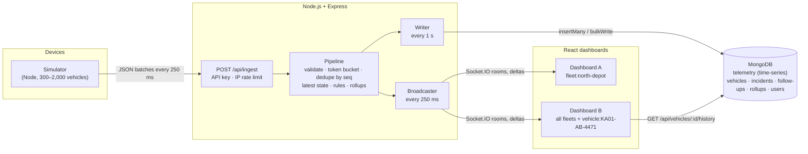

# Fleetwake

Fleetwake is the control room for a Bengaluru logistics operator that runs three fleets:

| Fleet | What it does | Vehicles |
| --- | --- | --- |
| North Depot | Heavy trucks hauling building materials out of the Peenya industrial area | Trucks, vans |
| Airport Shuttle | Buses and cabs carrying passengers and crew to Kempegowda Airport | Buses, SUVs, sedans |
| City Logistics | Last-mile parcel deliveries across the city | Vans, bikes, sedans |

Every vehicle reports GPS, speed, fuel and engine temperature once a second. Two kinds of people watch:
- **Dispatchers** see all three fleets and handle incidents as they happen: speeding, harsh braking, overheating, vehicles leaving their area, and long idling.
- **Fleet managers** see only their own fleet.

A second matters because an overspeeding truck or an overheating shuttle has to be caught while it's still happening, not in tomorrow's report.

Built for the MERNIFY hackathon, High-Throughput Streams & Telemetry track. The vehicles are simulated, driving real Bengaluru roads.

**Stack:** MongoDB · Express 5 · React 19 · Node.js 24 · Socket.IO 4

## The dashboard

Each page answers one question and offers the actions that go with it.

| Page | Question it answers | What you can do there |
| --- | --- | --- |
| **Control room** | What needs attention right now, and where is everything? | Work the **Needs attention** queue: open incidents, most urgent first, split into *happening now* and *stopped, needs review*. Take an incident, send the driver an instruction with one click, log a call, add notes, and resolve with an outcome. The live map rings vehicles with active incidents. Open a vehicle to see its driver, its last 5, 15 or 60 minutes joined to live readings, its open incidents, and to book coaching or a maintenance check. |
| **Reports** | Who needs coaching or a check, and how well are we responding? | Open incidents and how many are unassigned; median time to take ownership and to resolve; incidents per 100 km. **Drivers to follow up**, with *Book coaching* and *Book check* buttons; the list of booked follow-ups with *Mark done*. A **heatmap** of where incidents happen, filterable by type; incidents over time; how incidents were closed (with a hint when false alarms run high); fleets compared. |
| **System health** (dispatchers only) | Is the platform working? | A plain status (*All systems normal*, *Degraded* or *Problem*) and six checks: database, vehicle data, data quality, delivery to screens, storage, vehicles reporting. Each failing check says what to do. Charts of readings per second and delivery time, rejected readings by reason, every connected screen by fleet, and the last capacity test. |

Fleet managers (`north`, `airport`) see only their own fleet everywhere: the map, the queue, reports and the API. To see the server keeping screens apart, sign in as `admin` and as `north` in two windows, then open **System health → Connected screens** as `admin`.

## Working an incident

Repeated alerts don't flood the queue. Each vehicle has at most one unresolved incident per kind of problem (`server/src/pipeline/incidents.js`):

1. **Opened** when a rule trips. If it trips again before anyone resolves it, the count goes up (*3×*) and after three repeats a warning becomes critical.
2. **Stopped, needs review** when the condition ends on its own, for example back under the limit. A non-critical incident that stops and that nobody took closes itself after 10 minutes with the outcome *Cleared on its own*. Critical ones always wait for a person.
3. **Instruct the driver:** *Slow down*, *Return to route*, *Pull over and switch off*, *Resume trip* or *Call control room*. The instruction is queued and goes down to the vehicle in the response to its next upload, normally within a second. The driver's tablet confirms through `POST /api/devices/ack`.
   - If an instruction is not delivered in 2 minutes it expires.
   - If it is not confirmed within 60 s, the timeline says to call the driver.
   - The simulated drivers confirm after 3 to 9 seconds and then actually comply: they slow down, head back to their route, or pull over and switch off. About one in twelve never answers.
4. **Resolved** with an outcome (driver corrected it, assistance sent, false alarm, escalated, cleared on its own, other) and an optional note. Resolving can also book driver coaching or a maintenance check.

Every step lands in the incident's timeline with who did it and when. Incident changes reach every screen following that fleet within 250 ms.

## Early warnings (machine learning)

Fixed thresholds only fire once something is already wrong, and they can't tell a hot-running truck from a failing one. So every vehicle also gets its own small model that learns, continuously and on the server, what is normal *for that vehicle* (`server/src/pipeline/ml.js`). It needs no external service and no API key.

| Detector | What it learns | What it catches | Example incident text |
| --- | --- | --- | --- |
| **Overheat forecast** | The engine's expected temperature at each speed. It fits a linear trend to the *unexplained* heat over the last 90 s. | An engine heading for 105 °C, minutes before the fixed overheat rule can fire | "Engine 97 °C and rising 6.2 °C/min: about 1 min to 105 °C" |
| **Unusual engine temperature** | A per-vehicle baseline `engine ≈ a + b·speed` (exponentially weighted least squares, ~30 min memory) and the vehicle's own spread around it | A slow coolant leak that tops out around 100 °C and never trips the fixed rule | "Engine 101 °C, 9 °C hotter than this vehicle usually runs at 42 km/h (normal 92 °C)" |
| **Unexplained fuel loss** | The vehicle's own fuel use per km | Fuel that the distance driven doesn't explain: siphoning while parked, or a leak | "Fuel fell 7.9% in 2 min while parked; the distance explains about 0.0%" |

Each early warning becomes an ordinary incident, labelled *Early warning*. It is worked like any other, with a suggested instruction: *Pull over and switch off* for a forecast overheat, *Call control room* for the other two. The incident panel shows the evidence ("its engine normally runs at 92 °C at this speed, ±0.5 °C"), and the vehicle panel shows what the model has learned so far.

Safeguards that matter in practice:
- **Warm-up.** Nothing is judged until a vehicle has about 3 minutes of readings.
- **Slow drift can't become normal.** The model only learns from readings within two standard deviations of its current normal. Without this, a slow leak would widen "normal" one step at a time and never be flagged (a unit test covers exactly this).
- **Speed is accounted for.** Speeding up legitimately warms an engine, and an engine catching up after pulling away from a stop climbs too. Neither raises a forecast, because the forecast only trends heat beyond the vehicle's normal and needs the engine to be already measurably hotter than usual.
- **Learning survives restarts.** Learned baselines are saved with each vehicle's state every 5 s and restored on start.
- **System health check.** System health shows how many vehicles have a trained model.

**Measured against ground truth.** A 20-minute run used 300 simulated vehicles with faults injected about 30 times more often than normal, and `--truth` logged every injected fault. Each early warning was then matched to a real fault on the same vehicle:

| Detector | Precision (warnings that matched a real fault) | Recall (faults caught, after warm-up) | Fixed 105 °C rule on the same faults |
| --- | --- | --- | --- |
| Overheat forecast | 80% (12 of 15) | 9 of 11 overheats | Caught all 11, but the forecast warned a **median 78 s earlier** (66 to 82 s) |
| Unusual engine temperature | 94% (15 of 16) | 3 of 5 coolant leaks | Caught 0 of 5: the leak never reaches 105 °C |
| Unexplained fuel loss | 100% (24 of 24) | 9 of 12 thefts | No fixed rule can see this |

The few unmatched warnings were on vehicles that had a real overheat a few minutes earlier, still settling after it. The samples are small and the faults are simulated, so treat these as evidence that the approach works, not as production accuracy.

Getting here took three rounds, and the rounds are what made the models trustworthy:
1. **First version:** overheat forecasts were only 32% precise. They fired whenever a vehicle braked to a stop, because the baseline used instantaneous speed while the engine cools over about a minute. The baseline now uses speed smoothed over the engine's thermal response.
2. **Second version:** the forecast fell to 13%, because the baselines were trusted too early (the engine still settling after start-up, only one cruising speed seen). A model now judges only after about 2.5 minutes of settling, 3 minutes of learning, and driving at a range of speeds.
3. Each fix came with a unit test that reproduces the false alarm.

To reproduce, run the simulator with `--anomaly 30 --truth faults.jsonl` and compare the `incidents` collection with the file.

## How this meets the brief

| Requirement in `MERNIFY_ProblemStatement.md` | Where it's met |
| --- | --- |
| Ingest continuous streams from multiple sources | Simulator: 300 vehicles by default, tested at 2,000, each a separate source → `POST /api/ingest` |
| Process events and maintain system state | `server/src/pipeline/pipeline.js`: latest state per vehicle, rules, per-minute rollups |
| Store telemetry for historical retrieval and analysis | MongoDB time-series `telemetry` collection, plus `rollups` that the Reports page reads |
| Broadcast relevant updates in real time | Socket.IO `fleet:<id>` and `vehicle:<id>` rooms, field-level deltas every 250 ms |
| Interactive visualisations, including charts, maps and heatmaps | Live map, uPlot charts, incident heatmap on Reports |
| History alongside live data without duplicates or inconsistency | Vehicle panel: join the room, hold events, load history (including unflushed events), merge by `seq` |
| Events identify source, event and time, and handle duplicates and out-of-order events | `vehicleId` + `seq` + `ts`; equal `seq` is dropped as a duplicate, lower `seq` as late |
| Stay responsive under frequent updates | Store mutated per message, React re-renders at most 4 times a second, windowed vehicle list, canvas charts |
| Socket.IO rooms or namespaces for subscriptions | Fleet chips in the top bar join and leave `fleet:<id>` rooms; opening a vehicle joins `vehicle:<id>`; System health lists every room and its screens |
| Input validation and rate limiting | Strict Zod schema, per-IP limit, per-device token bucket, device API key |
| Basic authentication and access control | JWT logins; dispatcher and fleet-manager roles checked on every room join and API call |
| **Bonus:** batching, throttling, windowing on the client | 4 Hz UI tick, windowed list, coalesced fleet batches |
| **Bonus:** independent subscriptions per client | Each screen picks its fleets; the server filters by account |
| **Bonus:** historical analysis | Reports page |
| **Bonus:** anomaly detection and alerts | Per-vehicle learned models raise early warnings before fixed limits are crossed (see [Early warnings](#early-warnings-machine-learning)). Six rules feed incidents that merge repeats, escalate, auto-close, and are worked with driver instructions, calls, notes and outcomes (see [Working an incident](#working-an-incident)) |
| **Bonus:** backpressure and rate limiting | 503 + `Retry-After` when the write buffer fills; slow sockets get a fresh snapshot instead of a queue |
| **Bonus:** performance measurements | `npm run stress`, results below and on the System health page |
| **Bonus:** hosting | Not deployed yet. `npm run build && npm start` serves everything from one port, ready for Render or Railway with a MongoDB Atlas URI. |

## What it does

- **Ingest at fleet scale.** Tested at 2,000 vehicles × 1 Hz, about 2,000 events per second, with 50 dashboards connected (see [Measured performance](#measured-performance)).
- **Per-fleet subscriptions.** Each dashboard joins Socket.IO rooms for the fleets it picked and receives nothing else. Access is enforced on the server: a fleet manager can only join their own fleet's room.
- **History merged with live data.** Opening a vehicle loads its last 5, 15 or 60 minutes from MongoDB and keeps it running from the live stream. The merge has no gaps and no duplicate points, and the seam between history and live data is drawn on both the chart and the map trail.
- **Incident detection** on every event as it arrives:
  - overspeed: above the zone limit for 10 s
  - harsh braking: deceleration beyond 0.4 g
  - long idle: engine on and stationary for 15 min
  - left area: outside the fleet's operating area
  - engine overheat: 105 °C or more for 30 s (clears below 100 °C)
  - not reporting: a vehicle went silent while driving

  Rules also report when a condition ends, so incidents know when they have stopped.
- **Early warnings from machine learning:** each vehicle's own learned model forecasts overheating, spots an engine running hotter than that vehicle normally does, and flags fuel loss the distance doesn't explain.
- **Driver instructions** go down to the vehicle with its next upload, and the driver's confirmation comes back the same way.
- **Follow-ups:** coaching and maintenance checks booked from incidents, vehicles or reports, tracked until done.
- **Protection against bad input:** schema validation, a per-IP rate limit, a per-device token bucket, a device API key, 503 backpressure when the write buffer fills, and JWT logins with fleet-scoped access.

## Run it

You need Node.js 20 or newer (tested on 24) and MongoDB 6 or newer (tested on 8), running locally or on Atlas.

```sh
npm install
cp .env.example .env          # then edit MONGO_URI / JWT_SECRET if needed
npm run db                    # start a local MongoDB with its data in .mongo-data/
npm run dev                   # server :4000, dashboard :5173, simulator with 300 vehicles
```

`npm run db:stop` shuts that MongoDB down. On Linux kernels 6.19 and newer, the MongoDB 8.0 systemd service (`systemctl start mongod`) refuses to start ([SERVER-121912](https://jira.mongodb.org/browse/SERVER-121912)), but starting `mongod` directly as above works. If the dashboard shows "Request failed (502)", the server is not running, usually because MongoDB isn't.

Open http://localhost:5173 for the landing page, then **Open dashboard**. On first start the server creates three demo accounts:

| Username | Password | Sees |
| --- | --- | --- |
| `admin` | `admin123` | Dispatcher: all three fleets |
| `north` | `north123` | Fleet manager: North Depot only |
| `airport` | `airport123` | Fleet manager: Airport Shuttle only |

To show the per-fleet access control, sign in as `admin` in one window and as `north` in another. Both receive live updates, but only for the fleets each is allowed to see.

### Other commands

| Command | What it does |
| --- | --- |
| `npm run dev:nosim` | Server and dashboard without the simulator |
| `npm run simulate -- --vehicles 1000 --anomaly 5` | Simulator on its own (see `--help` for the duplicate, late and malformed rates) |
| `npm run stress -- --vehicles 2000 --clients 50 --duration 60` | Load test. Writes `stress-results.json`, which System health displays. |
| `npm test` | Unit tests for validation, dedupe, rate limiting, deltas, every rule, the incident workflow, and the early-warning models (including false-alarm checks) |
| `npm run build && npm start` | Production: Express serves the landing page at `/`, the built dashboard at `/dashboard/`, and the API and Socket.IO on one port |

For a quick demo of the long-idle rule, set `IDLE_ALERT_SEC=120` in `.env`.

## How it works



### Data generation

`simulator/index.js` drives each vehicle along a hand-drawn polyline on a real road: Outer Ring Road, Tumkur Road, Bellary Road to the airport, Hosur Road, Old Airport Road or Mysore Road. Their coordinates are approximate and live in `shared/geo.js`. Speed follows a cruise target capped below the local speed limit, and fuel and engine temperature drift realistically.

Each vehicle reports at its own phase within the second, as unsynchronised devices would. Now and then a vehicle starts an episode:
- speeding
- a hard stop
- overheating
- idling
- parking with the engine off
- driving out of its fleet's geofence
- losing signal for a minute or so (a dead zone)
- a failing fan (engine climbs towards 112 °C over a couple of minutes), a slow coolant leak (+1 °C a minute), or fuel siphoned while parked. These exercise the early-warning models. `--truth file.jsonl` logs every injected fault so the models can be scored against it.

The network is unreliable on purpose: by default 1% of events are sent twice and 0.5% arrive out of order, so the dedupe logic is always being exercised.

A telemetry event:

```json
{ "vehicleId": "KA01-AB-4471", "seq": 17945607879, "ts": 1794560807035, "type": "position",
  "lat": 12.97194, "lng": 77.59369, "speedKmh": 42.6, "fuelPct": 61, "engineC": 88, "heading": 74, "engineOn": true }
```

`vehicleId` and `seq` identify the event: `seq` only ever increases for a device. `ts` is the device time, in epoch milliseconds or ISO-8601.

### Ingestion and processing (`server/src/pipeline/`)

1. **Gate.** The device key is checked, then an IP rate limit is applied. A request carries up to 1,000 events.
2. **Validation.** Each event is checked by a strict Zod schema. Timestamps more than 60 s in the future or older than 24 h are rejected, and so are unregistered vehicles.
3. **Per-device token bucket:** 5 events/s on average, bursts of 20.
4. **Dedupe.** An event whose `seq` equals the vehicle's last accepted `seq` is a duplicate; a lower `seq` is late. Both are dropped and counted. This keeps retries from a flaky link from double-counting.
5. **Accepted events:**
   - update the in-memory latest state
   - run the rules
   - add to the per-fleet, per-minute rollup
   - join the write buffer and the broadcast queues

   The pipeline does no I/O itself, which is why it can be unit-tested.
6. **Writes.** Every second the writer drains the buffer:
   - raw events into a **MongoDB time-series collection** (`telemetry`, 7-day TTL) with one unordered `insertMany`
   - changed incidents with one `replaceOne` upsert each, in a single `bulkWrite`
   - rollups with a `$max` upsert
   - latest vehicle states every 5 s, since they are served from memory and the database copy is only needed after a restart

   If the buffer passes `MAX_PENDING_WRITES`, ingest answers **503 with `Retry-After`** and the simulator backs off.

### Real-time delivery (`server/src/realtime/socket.js`)

Dashboards connect with their JWT; the handshake is rejected without one.

| Room | Joined by | Receives |
| --- | --- | --- |
| `fleet:<id>` | `subscribe { fleets }`, filtered to the user's fleets. The ack carries a full snapshot. | `fleet:batch` every 250 ms |
| `vehicle:<id>` | `watch { vehicleId }` while a vehicle is open | `vehicle:events`, every raw event |
| `metrics` | dispatchers only | `metrics` with health checks, once a second |

Incidents that changed are sent to their fleet room as an `incidents` message on the same 250 ms tick.

To keep payloads small:
- **Coalescing.** A fleet batch carries at most one entry per vehicle per 250 ms, however many events arrived in that window.
- **Field-level deltas.** After the first send, an entry holds only the fields that moved past a threshold. For example, a vehicle whose speed alone changed is sent as `["KA01-AB-4471", 17945607880, 1794560808035, {"sp": 45}]`.
- **Compact keys.** Fields use short keys and rounded values.
- **Watched vehicles only.** Per-event streams go only to vehicles somebody has open.

**Slow clients.** A socket whose outgoing buffer backs up leaves its fleet rooms. When the buffer drains, it gets one fresh snapshot and rejoins. A slow client receives the latest state, not a growing queue of stale batches.

**Client side** (`client/src/lib/live.js`):
- Socket messages mutate a plain store, and React re-renders at most **4 times a second**, so hundreds of updates cost one render.
- The vehicle list is **windowed**: only visible rows render.
- Charts use **uPlot** (canvas).
- The map updates one GeoJSON source per tick.

### History plus live without gaps or duplicates

Opening a vehicle (`client/src/components/VehicleDetail.jsx`) runs these steps:
1. Join `vehicle:<id>` and **hold** incoming events.
2. Fetch history. The server reads MongoDB **and adds events still in its write buffer**, deduped by `seq`. Otherwise an event accepted in the last second would be in neither list.
3. Merge history and the held events into one map keyed by `seq`, so any overlap is dropped and counted.
4. Treat the last history `seq` as the seam. The chart draws history in beige, an orange seam marker, and live data in near-black. The map trail uses the same colours.

The panel footer shows the merge, for example "191 from history + 5 live · 1 overlapping dropped".

### Data model

| Collection | Contents |
| --- | --- |
| `telemetry` (time-series, `timeField: ts`, `metaField: meta`) | `{ ts, meta: { vehicleId, fleetId }, seq, lat, lng, speedKmh, fuelPct, engineC, heading, engineOn }` |
| `vehicles` | Registry and latest state. `_id` is the vehicle id, and `seq` is restored on boot so dedupe survives restarts. |
| `incidents` | `{ vehicleId, fleetId, driver, rule, severity, status: active \| cleared \| resolved, ts, lastSeenAt, clearedAt, resolvedAt, count, message, value, readings, owner, outcome, note, commands[], timeline[] }` |
| `followups` | `{ vehicleId, fleetId, driver, kind: coaching \| maintenance, reason, incidentId, due, status: open \| done, createdBy, doneBy, doneAt }` |
| `rollups` | `{ fleetId, bucket (minute), events, km, speedSum, speedMax, vehicles }`. Reports read these, never raw telemetry. |
| `users` | `{ username, passwordHash (bcrypt), role: admin \| dispatcher, fleets }` |

## Measured performance

Both runs used one laptop running MongoDB, the server, the simulator and all 50 dashboard sockets at once, so the client-side numbers include that contention. Each run measured for 60 s after a 12 s warm-up; reproduce with `npm run stress`.

| Measure | Simulator batches every 250 ms | Simulator batches every 100 ms |
| --- | --- | --- |
| Simulated vehicles at 1 Hz | 2,000 | 2,000 |
| Dashboards connected | 50 of 50 | 50 of 50 |
| Events received / accepted per second | 2,021 / 1,992 | 2,021 / 1,992 |
| Written to MongoDB in 60 s | 119,505, no write errors | 119,522, no write errors |
| Device event to dashboard, p50 / p95 / p99 | 311 / 430 / 450 ms | 211 / 349 / 378 ms |
| Batches per dashboard per second | 12 (3 fleets × 4) | 12 |
| Payload per dashboard (all 3 fleets) | 149 KB/s | 149 KB/s |
| Server event-loop delay p99, peak | 30 ms | 96 ms |
| Server memory, peak RSS | 381 MB | 389 MB |

Latency is bounded by the two batching windows: the simulator's send interval plus the server's 250 ms broadcast window. Lowering `BROADCAST_MS` trades more, smaller messages for lower latency.

The accepted count sits about 1.5% below received because of the injected duplicates and out-of-order events, which the server dropped as designed.

## Project layout

```
landing/       Single-file Three.js landing page, served at /
client/        React dashboard (Vite), served at /dashboard/
server/        Express API, Socket.IO, pipeline, MongoDB models, unit tests
simulator/     Fleet simulator and stress test
shared/geo.js  Fleets, geofences, speed zones and routes used by server and simulator
```

## Credits

- [Socket.IO](https://socket.io), [Express](https://expressjs.com), [Mongoose](https://mongoosejs.com), [React](https://react.dev), [React Router](https://reactrouter.com), [Vite](https://vite.dev): MIT.
- [Zod](https://zod.dev) (MIT), [express-rate-limit](https://github.com/express-rate-limit/express-rate-limit) (MIT), [helmet](https://helmetjs.github.io) (MIT), [jsonwebtoken](https://github.com/auth0/node-jsonwebtoken) (MIT), [bcryptjs](https://github.com/dcodeIO/bcrypt.js) (BSD-3).
- [MapLibre GL JS](https://maplibre.org): BSD-3. Map data © [OpenStreetMap](https://www.openstreetmap.org/copyright) contributors (ODbL), served by [OpenFreeMap](https://openfreemap.org). The navy map style is our own.
- [uPlot](https://github.com/leeoniya/uPlot): MIT.
- [Three.js](https://threejs.org) r128 (MIT) for the landing page. The scroll-driven storytelling was inspired by [Kage](https://github.com/MengTo/kage) by Meng To, and the saloon's look draws on the [VEYRA interactive car](https://github.com/amirmushichge/veyra-interactive-car) design study by Amir Mušić. No code, artwork or media is reused from either. The content structure takes cues from motorq.com.
- Fonts: Big Shoulders Display, Instrument Sans and IBM Plex Mono, from Google Fonts (SIL Open Font License).
- Route coordinates are approximate, hand-drawn traces of public roads.
