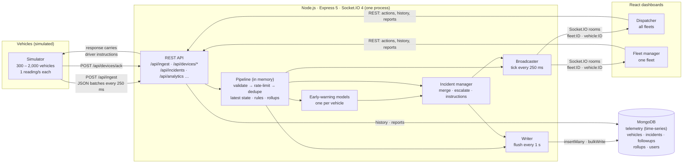
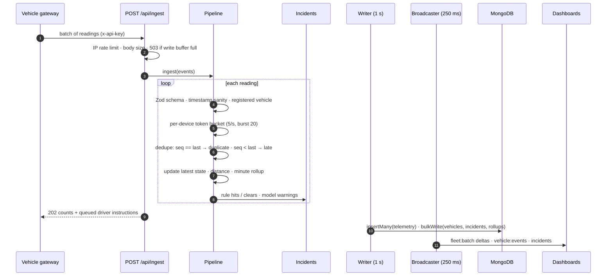
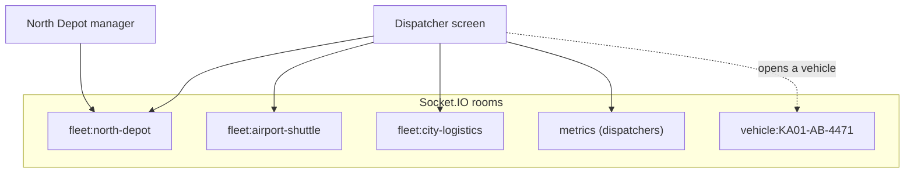
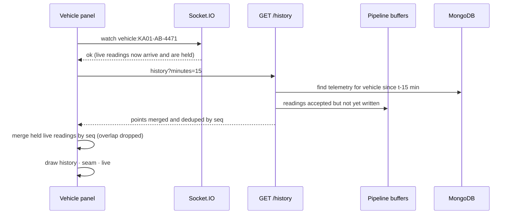
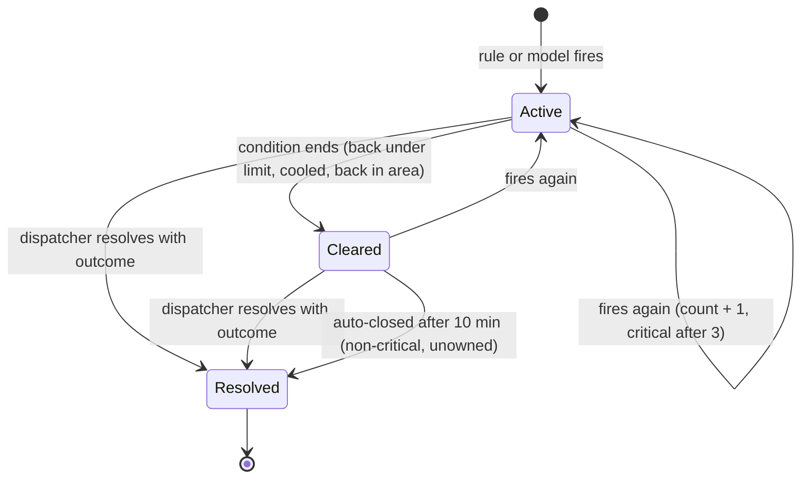
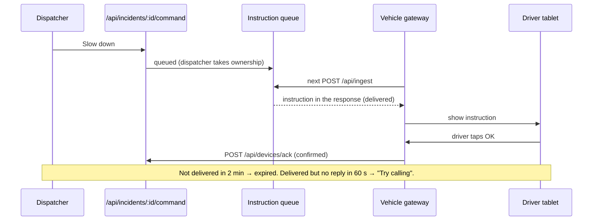
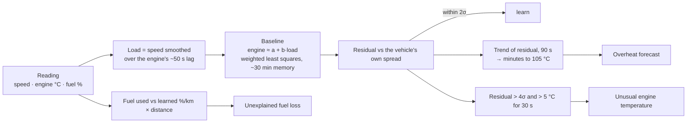

# Fleetwake architecture

This document covers the design in depth: components, data flow, the real-time protocol, the data model, the incident workflow, the early-warning models, and the performance techniques. For setup and a feature tour, see the [README](../README.md).

- [1. System overview](#1-system-overview)
- [2. Ingestion pipeline](#2-ingestion-pipeline)
- [3. Real-time delivery](#3-real-time-delivery)
- [4. History merged with live data](#4-history-merged-with-live-data)
- [5. Incidents and driver instructions](#5-incidents-and-driver-instructions)
- [6. Early-warning models](#6-early-warning-models)
- [7. Data model](#7-data-model)
- [8. Security and access control](#8-security-and-access-control)
- [9. Performance techniques](#9-performance-techniques)
- [10. API reference](#10-api-reference)

## 1. System overview



| Component | Code | Responsibility |
| --- | --- | --- |
| Simulator | `simulator/index.js` | Drives vehicles along real Bengaluru roads, injects faults and network problems, follows driver instructions |
| REST API | `server/src/routes/api.js` | Device gateway, login, vehicles, history, incidents, follow-ups, reports, system health |
| Pipeline | `server/src/pipeline/pipeline.js` | Validation, per-device rate limit, dedupe, latest state, rules, rollups, broadcast and write queues. No I/O, unit-tested directly. |
| Rules | `server/src/pipeline/rules.js` | Fixed-threshold detection; reports when a condition starts *and* ends |
| Early warnings | `server/src/pipeline/ml.js` | Per-vehicle online models: overheat forecast, unusual engine temperature, unexplained fuel loss |
| Incidents | `server/src/pipeline/incidents.js` | Merging, escalation, auto-close, instruction queue and delivery, timeline |
| Writer | `server/src/pipeline/writer.js` | Drains buffers into MongoDB every second |
| Realtime | `server/src/realtime/socket.js` | Socket.IO auth, rooms, 250 ms broadcast tick, slow-client handling, metrics |
| Dashboard | `client/` | React 19 + Vite, MapLibre map, uPlot charts |
| Landing page | `landing/index.html` | Static Three.js page served at `/` |
| Shared | `shared/geo.js`, `shared/people.js` | Fleets, zones, routes, drivers, instructions; used by server, simulator and dashboard |

Everything runs in one Node process, which keeps live state in memory. That is why it needs an always-on host (Render, Railway, Fly, a VM or Docker), not a serverless platform.

## 2. Ingestion pipeline



**The event.** Each reading identifies its source (`vehicleId`), its place in that source's stream (`seq`, strictly increasing per device), and when it was taken (`ts`):

```json
{ "vehicleId": "KA01-AB-4471", "seq": 17945607879, "ts": 1794560807035, "type": "position",
  "lat": 12.97194, "lng": 77.59369, "speedKmh": 42.6, "fuelPct": 61, "engineC": 88, "heading": 74, "engineOn": true }
```

**Duplicates and ordering.** The pipeline keeps the last accepted `seq` per vehicle in memory, restored from MongoDB on start. An equal `seq` is a retry (duplicate); a lower one arrived late. Both are dropped and counted, so a flaky mobile link can never double-count a trip or make a vehicle jump backwards.

**Backpressure.** Readings wait in a write buffer, and the writer drains it every second. If the buffer reaches `MAX_PENDING_WRITES` (100,000), ingest answers `503` with `Retry-After`. The simulator keeps the batch and retries, so data is delayed rather than lost.

## 3. Real-time delivery



| Room | Joined by | Receives |
| --- | --- | --- |
| `fleet:<id>` | `subscribe { fleets }`, filtered to the fleets the account may see; the ack carries a full snapshot | `fleet:batch` every 250 ms; `incidents` when one changes |
| `vehicle:<id>` | `watch { vehicleId }` while a vehicle panel is open | `vehicle:events`: every raw reading for that vehicle |
| `metrics` | dispatchers only | `metrics` once a second: rates, latency, rooms and screens, health checks |

**What a batch looks like.** One entry per vehicle that changed in the last 250 ms, carrying only the fields that moved past a threshold, with short keys:

```json
{ "t": 1794560808250, "f": "north-depot",
  "d": [["KA01-AB-4471", 17945607880, 1794560808035, { "sp": 45, "la": 12.97201 }]] }
```

**Slow clients.** If a socket's outgoing buffer backs up, it is taken out of its fleet rooms. When the buffer drains, it receives one fresh snapshot and rejoins. A slow screen gets the latest state, never a growing queue of stale batches.

**On the client** (`client/src/lib/live.js`):
- Messages mutate a plain store and React re-renders at most 4 times a second, so 500 updates in a second cost 4 renders.
- The vehicle list is windowed, the charts draw to canvas (uPlot), and the map replaces one GeoJSON source per tick.

## 4. History merged with live data



Joining the room *before* fetching history, and having the server add readings that are still in its write buffer, closes both gaps:
- a reading that arrived during the fetch is in the held live list
- a reading accepted in the last second, but not yet in MongoDB, is in the history response

Keying both lists by `seq` removes the overlap. The chart and map trail mark the seam where history ends and live data begins.

## 5. Incidents and driver instructions



There is one unresolved incident per vehicle and kind of problem, so repeats raise a count instead of flooding the queue. Every change is appended to the incident's timeline with who did it.



Instructions ride on the response to the vehicle's own upload, so the downlink needs no extra connection. In testing, delivery took 0.35 s and the simulated driver confirmed after about 6.5 s. Resolving an incident can book a follow-up (driver coaching or a maintenance check), which Reports then tracks until it is marked done.

## 6. Early-warning models

Each vehicle has its own online model (`server/src/pipeline/ml.js`). It learns from that vehicle's readings only, so "unusual" means unusual for that truck.



| Detector | Fires when | Suggested instruction |
| --- | --- | --- |
| Overheat forecast | The engine is ≥ 4 °C and 4σ hotter than its normal for the current load, the excess is climbing ≥ 3 °C/min (R² > 0.7), and 105 °C is ≤ 10 min away | Pull over and switch off |
| Unusual engine temperature | The excess is > 4σ and > 5 °C, sustained for 30 s | Call control room |
| Unexplained fuel loss | Fuel fell more than 3% beyond what the distance explains | Call control room |

**Safeguards.**
- **No judging too early.** The first 2.5 minutes after start-up are skipped while the engine settles, then 3 minutes are learned. Engine detectors also wait until the vehicle has driven at a range of speeds, so the first stop doesn't look abnormal.
- **No learning from anomalies.** Readings beyond 2σ are not learned from, so a slow coolant leak can't widen "normal" one step at a time.
- **Persistence.** Learned baselines are saved with the vehicle's state and restored on restart.

**Evaluation.** A 20-minute run used 300 vehicles with faults injected 30× more often than normal, and the simulator's `--truth` log recorded each fault:

| Detector | Precision | Recall | Compared with the fixed rule |
| --- | --- | --- | --- |
| Overheat forecast | 80% (12/15) | 9/11 | median **78 s earlier** than the 105 °C rule |
| Unusual engine temperature | 94% (15/16) | 3/5 coolant leaks | the fixed rule caught 0/5 |
| Unexplained fuel loss | 100% (24/24) | 9/12 thefts | no fixed rule exists |

Two earlier versions scored 32% and 13% precision on the overheat forecast. Their causes were engine lag at stops, and baselines trusted before the vehicle had driven at varied speeds. Each cause is now pinned by a unit test in `server/test/ml.test.js`.

## 7. Data model

```mermaid
erDiagram
  USER {
    string username PK
    string passwordHash "bcrypt"
    string role "admin | dispatcher"
    string[] fleets
  }
  VEHICLE {
    string _id PK "vehicleId"
    string fleetId
    string kind
    number seq "last accepted, for dedupe"
    date ts
    number lat
    number lng
    number speedKmh
    number fuelPct
    number engineC
    string status
    object ml "learned baseline"
  }
  TELEMETRY {
    date ts "timeField"
    object meta "vehicleId, fleetId"
    number seq
    number lat
    number lng
    number speedKmh
    number fuelPct
    number engineC
  }
  INCIDENT {
    objectId _id PK
    string vehicleId FK
    string fleetId
    string rule
    string source "rule | model"
    string severity
    string status "active | cleared | resolved"
    date ts
    number count
    object owner
    string outcome
    array commands
    array timeline
  }
  FOLLOWUP {
    objectId _id PK
    string vehicleId FK
    string kind "coaching | maintenance"
    string incidentId FK
    date due
    string status "open | done"
  }
  ROLLUP {
    string fleetId
    date bucket "minute"
    number events
    number km
    number speedSum
    number speedMax
  }
  VEHICLE ||--o{ TELEMETRY : reports
  VEHICLE ||--o{ INCIDENT : has
  INCIDENT ||--o| FOLLOWUP : books
  VEHICLE ||--o{ FOLLOWUP : needs
```



| Collection | Notes |
| --- | --- |
| `telemetry` | Native **time-series** collection (`timeField: ts`, `metaField: meta`), 7-day TTL, index `{meta.vehicleId, ts}` |
| `vehicles` | `_id` is the vehicle id. Upserted every 5 s, it gives a restart the last `seq` (so dedupe survives) and the learned model. |
| `incidents` | Indexes on `{fleetId, ts}`, `{vehicleId, ts}`, `{status, resolvedAt}` |
| `rollups` | One document per fleet per minute (unique index). Reports read these instead of scanning telemetry. |
| `followups` | Index on `{fleetId, status, due}` |
| `users` | Seeded with demo accounts on first start |

## 8. Security and access control

| Layer | Control |
| --- | --- |
| Devices | Shared `x-api-key`; IP rate limit (50 req/s); body limit 2 MB; at most 1,000 readings per request; strict Zod schema (unknown fields rejected); timestamps more than 60 s in the future or 24 h old rejected; unregistered vehicles rejected; per-device token bucket |
| People | bcrypt passwords; JWT (12 h); login rate limit (20/min) |
| Authorisation | The JWT's fleet list is checked on every REST route, every Socket.IO `subscribe` and `watch`, and every incident action. Fleet managers can't see or act on other fleets. System health is limited to dispatchers. |
| Transport | `helmet` headers. In production the server refuses to start with the default JWT secret or device key. |

## 9. Performance techniques

| Where | Technique |
| --- | --- |
| Ingest | Batched uploads; in-memory dedupe and state; one unordered `insertMany` per second; vehicle state persisted every 5 s instead of every reading |
| Storage | Time-series collection; per-minute rollups so reports never scan raw data |
| Broadcast | Coalesce to one entry per vehicle per 250 ms; field-level deltas with short keys; per-vehicle streams only for vehicles someone has open; slow-client resync instead of queueing |
| Client | Mutable store plus a 4 Hz render tick; windowed list; canvas charts; one map source update per tick |

**Measured** (`npm run stress`, one laptop running MongoDB, the server, the simulator and every dashboard socket): see the README's [performance section](../README.md#performance).

## 10. API reference

All routes are under `/api`. People send `Authorization: Bearer <jwt>`; devices send `x-api-key`.

| Method and path | Who | Purpose |
| --- | --- | --- |
| `POST /devices/register` | device | Register vehicles `[{ vehicleId, fleetId, kind }]` |
| `POST /ingest` | device | Upload readings; the response includes queued instructions |
| `POST /devices/ack` | device | Confirm instructions `[{ id, vehicleId }]` |
| `POST /auth/login` | anyone | `{ username, password }` → `{ token, user }` |
| `GET /fleets` | user | Fleets, zones, rule labels, instructions and outcomes for this account |
| `GET /vehicles` · `GET /vehicles/:id` | user | Snapshot; one vehicle with open incidents, follow-ups and its learned model |
| `GET /vehicles/:id/history?minutes=` | user | Raw readings merged with unwritten ones, deduped by `seq` |
| `GET /incidents` · `GET /incidents/:id` | user | Open incidents (or `?status=resolved`) |
| `POST /incidents/:id/ack \| command \| call \| note \| resolve` | user | Take ownership, instruct the driver, log a call, add a note, resolve (optionally booking a follow-up) |
| `GET /followups` · `POST /followups` · `POST /followups/:id/done` | user | Coaching and maintenance follow-ups |
| `GET /analytics?hours=&fleet=` | user | Reports data: response times, outcomes, incidents over time, heatmap points, fleets compared |
| `GET /system` · `GET /metrics` · `GET /stress-results` | dispatcher | Health checks, counters, last load test |
| `GET /health` | anyone | Liveness |

Socket.IO: clients emit `subscribe`, `watch` and `unwatch`; the server emits `fleet:batch`, `fleet:snapshot`, `vehicle:events`, `incidents` and `metrics`.
